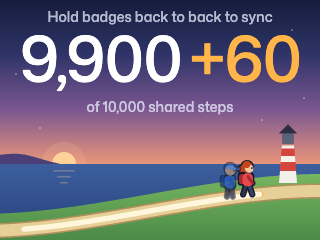

# Universe Walker

A two-player walking game for GitHub Badger 2350 badges (RP2350). Keep the
Walking app open while walking independently, then hold the badges back to
back to combine your steps toward a shared **10,000-step goal**. Separate them
before syncing again. Pairing starts from the hold gesture; no button is needed.



The white number is the last confirmed shared total. The equally large yellow
**+N** is your new local contribution; it joins the white total after a
successful sync. Before the first sync, the number shows your personal steps
and says they are not synced yet. Only confirmed shared progress lights the
lighthouse.

For demos, hold **UP** to add steps to your own count. A press adds one step;
after half a second the count speeds up gradually, reaching about 10,000
after roughly ten seconds. It stops once your unsynced +N reaches 9,957.
Releasing starts the slow ramp again, so a brief accidental press only adds a
few steps.

## Start here

- [Hardware guide](docs/hardware.md): install, reset demo progress, inspect a
  badge, and run the two-badge check.
- [Architecture](docs/architecture.md): data model, durable sync protocol,
  hardware timing constraints, and code map.
- [Agent guide](AGENTS.md): where to work and what must remain true.
- [Design preview](design-jig/walking/README.md): current browser previews and
  approved coast design.

## Local development

Use Python 3.10+ and Node.js 18+. Node runs the browser fixture checks within the
Python suite. Host tests do not require a connected badge or device packages.

```sh
python3 -m unittest discover -s tests -v
```

For USB tools, create a local environment and install the development
dependencies:

```sh
python3 -m venv .venv
source .venv/bin/activate
python3 -m pip install -r requirements-dev.txt
```

Serve the visual previews from the repository root:

```sh
python3 -m http.server 8765 --bind 127.0.0.1
```

Open [the walking preview](http://127.0.0.1:8765/design-jig/walking/fresh.html)
or [the count tuning jig](http://127.0.0.1:8765/design-jig/walking/counter.html).
These use fixture data and never write badge progress.

### Live badge dashboard

`dashboard/` mirrors both badges' screens side by side from their Bluetooth
adverts. Install `bleak` (in `requirements-dev.txt`), then run from a terminal
that has Bluetooth permission (on macOS, Terminal.app):

```sh
.venv/bin/python dashboard/server.py           # real badges
.venv/bin/python dashboard/server.py --demo    # simulated pair, no Bluetooth
```

Open <http://127.0.0.1:8765/>. While the badges pair, the screens draw
together with a linking animation. A confirmed sync shows the same total on
both screens and a full-window confetti burst. Outside a sync, a badge greys
out after 10 s without an advert.

## Repository

| Path | Purpose |
| --- | --- |
| `badge/apps/walking/` | Installable MicroPython app; uses the badge's existing firmware runtime. |
| `dashboard/` | Live two-badge screen mirror: BLE scanner, server and page. |
| `design-jig/walking/` | Plain HTML/JavaScript previews, approved renders, and vendored Dial Kit. |
| `tests/` | Python unit/integration tests, virtual badge harness, and Node fixture checks. |
| `tools/` | USB setup and diagnostics. |
| `docs/` | Current architecture and hardware guidance. |

Step counting, saved progress, and repeated two-badge exchanges have been
reported working on the physical demo badges. The latest large contribution
row and native font placement still need a visual check after installation;
browser screenshots and host tests cannot establish that result.
